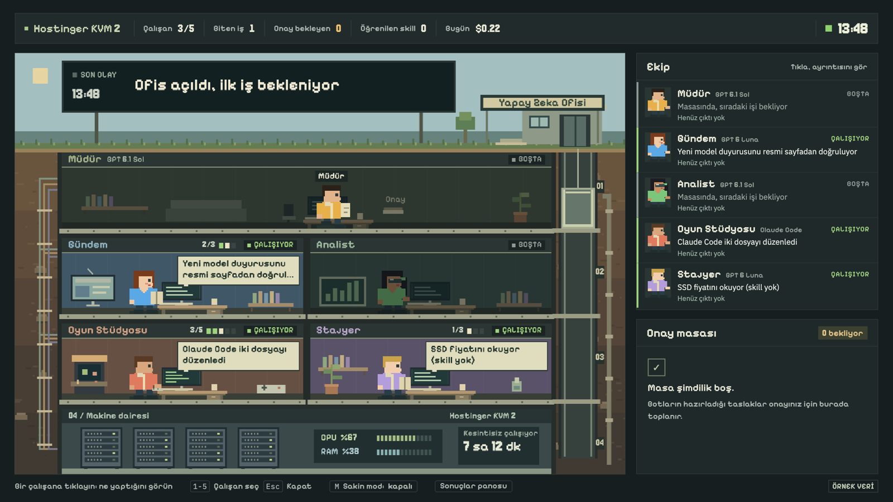

# Yapay Zeka Ofisi

Bilgisayarınız kapalıyken de iş yapan beş kişilik yapay zeka ekibi.
[Hermes Agent](https://github.com/NousResearch/hermes-agent) üzerinde çalışır.
Telegram'dan Müdür'e görev verirsiniz; ekip araştırır, fiyatları izler, içerik ve kod taslakları hazırlar.
Sonuçları dosyada toplar, kararınızı bekleyen işleri onay masasına koyar.

İçerik üreticileri, bağımsız geliştiriciler, satıcılar, öğrenciler ve küçük ekipler için uyarlanabilir bir başlangıçtır.
Hazır bir Hermes kurulumu üzerinde `bash kurulum/kur.sh` ile ofis kurulur. Model hesabı, Telegram bağlantısı ve
size ait kaynaklar ayrıca hazırlanır. Sunucu sürekli açıksa ofis de çalışmaya devam eder.



Demodaki olaylar, grafikler, sayılar ve mesajlar temsilidir.

## Beş adımda başlangıç

1. **Hermes'i hazırlayın.** [Hostinger Hermes şablonu](https://hostinger.com/ugurk10) veya
   zaten Hermes kurulu Linux/Docker ortamı. Öneri en az KVM 2, 2 vCPU ve 8 GB RAM. Repo Bash 4+ ve Python 3.10+ ister.
   Hostinger'da **UGURK10** koduyla %10 indirim alırsınız.
2. **Modeli ve Telegram'ı bağlayın.** Kapsayıcıda Hermes kullanıcısıyla `hermes model` çalıştırın.
   Telegram botunu Hermes panelinde Channels > Telegram benzeri bölümden bağlayın.
3. **Repoyu indirin, ortak bilgileri doldurun.** Kapsayıcıda:

   ```bash
   git clone https://github.com/UgurKeskekci/yapay-zeka-ofisi /opt/data/ofis-kurulum
   cd /opt/data/ofis-kurulum
   mkdir -p ozel/ortak
   cp botlar/ortak/* ozel/ortak/
   ```

   `ozel/ortak/` içindeki kurgusal Deniz örneğini, kanal kimliklerini ve ürün bağlantılarını değiştirin.
   Başka bir iş için [hazır senaryo](docs/05-senaryolar.md) seçebilirsiniz.
4. **Ofisi kurun ve kontrol edin.**

   ```bash
   bash kurulum/kur.sh
   bash kurulum/kontrol.sh
   ```

   Kod ve yükseltme kullanacaksanız aynı kullanıcıyla `claude` girişi de yapın.
5. **İlk görevi verin.** Telegram'dan “Ortak dosyaları kontrol edin, eksikleri söyleyin” yazın.
   Ardından [ilk gün rehberindeki](docs/02-ilk-gun.md) küçük görevleri deneyin ve ofis ekranını açın.

Root terminalinden kullanıcıya geçiş dahil bütün adımlar: **[01: Kurulum](docs/01-kurulum.md)**.
VPS ve model kullanımı ayrı hizmetlerdir; ücretsiz veya sınırsız kullanım vaat edilmez.
Hostinger linki satış ortaklığı linkidir: bu linkten alım yaparsanız bana komisyon düşer, size ek maliyeti yoktur.

## Rehberler

| Rehber | İçerik |
|---|---|
| [01: Kurulum](docs/01-kurulum.md) | Hostinger ve mevcut Linux/Docker yolları, model, Telegram, isteğe bağlı kod deposu |
| [02: İlk gün](docs/02-ilk-gun.md) | İlk görevler, gerçek rutin saatleri, çıktı ve yükseltme kontrolü |
| [03: Kullanım](docs/03-kullanim.md) | İş verme, geri bildirim, ürün ekleme, rutin ve model değiştirme |
| [04: Uyarlama](docs/04-uyarlama.md) | Çalışan ekleme, SOUL ve skill yazma, Node/Python/Expo örnekleri |
| [05: Senaryolar](docs/05-senaryolar.md) | Kopyalanabilir dosyalar, örnek konuşmalar ve saat önerileri |
| [06: Sorun giderme](docs/06-sorun-giderme.md) | Claude girişi, panel erişimi, X, rutin, Telegram ve limit sorunları |
| [07: Güvenlik](docs/07-guvenlik.md) | Anahtarlar, onay, depo kancası ve maliyet sınırları |

## Ekip

| Çalışan | Görevi | Varsayılan model |
|---|---|---|
| Müdür (`default`) | Telegram'daki muhatabınız. İşleri dağıtır, raporları birleştirir, onay masasını ve yükseltmeyi yönetir. | Mevcut ana profil modeli |
| Gündem (`gundem`) | Resmi model ve sürüm duyurularını izler, kaynaklı gündem ve X taslağı hazırlar. | `gpt-6-luna` |
| Analist (`analist`) | Tanımladığınız kanalları karşılaştırır, sıradaki içerik önerisini getirir. | `gpt-6.1-sol` |
| Oyun Stüdyosu (`oyun`) | Öncelikli projenin küçük hatasını yeniden üretir, Claude Code ile ayrı dalda düzeltir, doğrular. | `gpt-6.1-sol`, kod için ayrıca Claude Code |
| Stajyer (`stajyer`) | Fiyat ve aylık alışveriş takibi yapar, sosyal medya fikirleri hazırlar. Skill'siz ve skill'li yöntemleri karşılaştırır. | `gpt-6-luna` |

Model adlarını sağlayıcınızda erişebildiğiniz modellerle değiştirin.
Kurulum [rutinler.md](botlar/rutinler.md) içindeki **normal** saatleri kurar; daha sık çalışma için `OFIS_RUTIN=yogun`. Saatler Türkiye saatidir.

## Hazır senaryolar

- [İçerik üreticisi](ornekler/icerik-ureticisi/): gündem, kanal analizi, fikir taslağı.
- [E-ticaret satıcısı](ornekler/e-ticaret/): rakip fiyat ve görünür stok takibi, ürün açıklaması.
- [Bağımsız geliştirici / küçük SaaS](ornekler/bagimsiz-gelistirici/): hata turu, kullanıcı yorumu, sürüm notu.
- [Üniversite öğrencisi](ornekler/ogrenci/): PDF notlarından sınav özeti, haftalık çalışma planı.
- [Serbest çalışan / küçük ajans](ornekler/serbest-calisan/): açık ilan takibi, teklif ve müşteri raporu taslağı.

Uygulama örneği: `cp -r ornekler/ogrenci/* ozel/`. Önce eski dosyalarınızı yedekleyin, yer tutucuları doldurun;
sonra `kur.sh` çalıştırın ve eski rutinleri uyarlayın. Kopyalama cron saat ve istemlerini değiştirmez.
[Senaryo rehberi](docs/05-senaryolar.md) gerekli adımları açıklar.

## Ne YAPMAZ

Dışarıya gönderi, e-posta veya müşteri mesajı göndermez. Satın almaz, sepete eklemez, hesaba girmez.
PR açmaz, PR birleştirmez ve sürüm yayımlamaz. Paylaşımı ve son kararı siz verirsiniz.
Ofis içi Telegram raporları ve yapılandırılmış kod deposunda `ofis/` dalına gönderim bu sınırın tanımlı istisnalarıdır.
[El kitabı](botlar/EL-KITABI.md) çalışma kuralıdır; ayrı bir teknik yetki sistemi yerine geçmez.

## Ofis ekranı

Kendi bilgisayarınızda repo kopyası içinden:

```bash
python3 arayuz/sunucu.py --uzak root@SUNUCU_IP --anahtar ~/.ssh/ANAHTARINIZ
```

`SUNUCU_IP` ve anahtar yolunu değiştirin. `http://localhost:8790/ofis/` ofis, `/pano/` çıktılar,
`/telefon/` telefon görünümüdür. Arayüz SSH ile sunucudaki Docker kapsayıcısını okur, yeni dış port açmaz.
Kapsayıcı verilmezse adında `hermes` geçen ilk çalışan kapsayıcı seçilir;
birden çoksa `--kapsayici KAPSAYICI_ADI` kullanın. Uzak yollar Hostinger `/opt/data` düzenine göre sabittir.
`--uzak` olmadan temsili verili demo açılır. Canlı maliyet tahminidir, fatura veya kesin kota değildir.
Ek çalışanlar Hermes'te kullanılabilir; mevcut ekran beş varsayılan oda ve çalışanla sınırlıdır.

## Yükseltme

Çalışan kendi yedek yolunda da takılırsa görevi, denediklerini ve hatayı `~/ofis/yukselt/` içine yazar.
Müdür'ün dakikalık betiği bunu sunucudaki Claude Code'a verir. Başarılı sonuç `ciktilar/mudur/*-cozum.md`
dosyasına düşer, özet Telegram'a gelir. Ekranda süreç “Claude Code çözüyor” diye görünür.
Claude Code da çözemezse sizden gereken bilgi veya erişim söylenir. Giriş, araç veya erişim olmadan çözüm garanti edilmez.
Yükseltme Claude Code kullanımı tüketir; [maliyet kontrolünü](docs/07-guvenlik.md) okuyun.

## Özel ayarlar ve tekrar kurulum

`ozel/` Git'e girmez. `ozel/ayar.sh` kurulumun başında çalıştırılır, aynı adlı ortam değişkenlerini ezebilir.
`ozel/ortak/` ortak örneklerin üzerine en son uygulanır.
`ozel/botlar/<ad>/SOUL.md` repodaki rol yerine kullanılır; kaynak dosya değiştirilmez.
Çalışan eklemek için `bash kurulum/calisan-ekle.sh editor "Editör" "Taslakları denetler"` kullanın.

Tekrar kurulum aynı adlı profil ve rutinleri çoğaltmaz. SOUL ve kurulum dosyalarını yeniler;
mevcut `tercihler.md`, `is-listesi.md`, `fiyat-takip.json`, `sahip.md`, `sosyal.md` dosyalarını korur.
Diğer ortak örnekleri yeniden kopyalar, ardından özel ortakları uygular.
Canlı dosyalardaki öğrenimleri eski `ozel/ortak/` kaynağıyla ezmemek için önce yedekleyip eşitleyin.
Mevcut cron saati ve istemi değişmez. [Ayrıntılı güncelleme akışı](docs/01-kurulum.md).

Kod deposu isteğe bağlıdır. `OFIS_REPO` boşsa depo ve deploy anahtarı atlanır.
Doluysa ilk kurulum anahtar üretir; açık anahtarı ilgili GitHub deposuna ekledikten sonra
`bash kurulum/kur.sh repo` ile klonlayın. `kod.yerel_kopya` ve `~/ofis/repo/<OFIS_REPO_AD>` aynı yer olmalıdır.
Yerel gönderim kancası yalnız `ofis/` dallarına izin verir; [koruma sınırı](docs/07-guvenlik.md).

## Ortam değişkenleri

| Değişken | Varsayılan | İşlev |
|---|---|---|
| `OFIS_REPO` | Boş | İsteğe bağlı kod deposu. Boşsa anahtar ve klonlama atlanır. |
| `OFIS_REPO_AD` | `proje` | SSH anahtarı, takma adı ve repo klasörü. Harf/rakamla başlar; harf, rakam, kısa tire, alt çizgi içerir. |
| `OFIS_GODOT` | `0` | `1` ise Godot kurulur ve depo adımında başsız içe aktarma yapılır. |
| `OFIS_ARACSIZ` | Boş | `1` ise Claude Code/Godot araç ve Claude HOME bağlantısı adımı atlanır. |
| `OFIS_GUCLU_MODEL` | `gpt-6.1-sol` | Analist ve Oyun Stüdyosu modeli; Müdür ana profil modelini korur. |
| `OFIS_UCUZ_MODEL` | `gpt-6-luna` | Gündem, Stajyer ve yeni eklenen çalışanların varsayılan modeli. |
| `OFIS_EV` | `/opt/data` | Root'tan Hermes kullanıcısına geçişte HOME. |
| `HERMES_HOME` | Normal kullanıcıda `$HOME/.hermes`, root geçişinde `/opt/data` | Hermes veri ve profil dizini. Hostinger'da `/opt/data` kullanın. |
| `OFIS_DIZIN` | Kurulumda `$HOME/ofis` | Python betikleri önce bu değeri, yoksa mevcut `/opt/data/ofis`, sonra `~/ofis` yolunu kullanır. |
| `YUKSELT_MODEL` | `opus` | Claude Code yükseltme modeli, Hermes modelinden ayrıdır. |
| `OFIS_RUTIN` | `normal` | Rutin sıklığı: `normal` ya da `yogun` (daha sık, daha çok model kullanımı). |
| `YUKSELT_SURE` | `900` | Bir yükseltme sürecinin en uzun süresi, saniye. Harcama limiti değildir. |

`OFIS_DIZIN`, `HERMES_HOME` ve `YUKSELT_*` değerlerini zamanlı işler için Hermes hizmet ortamında da tanımlayın.
`TZ_OFIS`, `kur.sh` içinde `Europe/Istanbul` olarak tanımlı bir sabittir, dış ortam değişkeni değildir.
Hermes'in burada gösterilmeyen ayarları için ayrıntı: [Hermes belgesi](https://github.com/NousResearch/hermes-agent).

## Lisans

[MIT](LICENSE). Hermes Agent ve kullanılan dış araçların lisans ve hizmet koşulları ayrıca geçerlidir.
